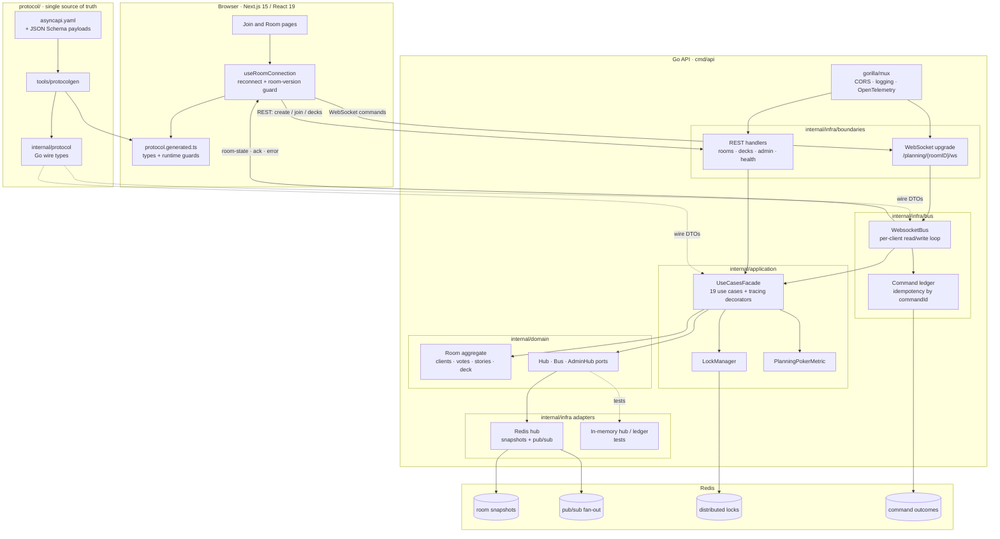

# Planning Poker

A full-stack Planning Poker application for agile teams, built with Go (backend) and Next.js/React (frontend).

## Features

- Real-time collaborative estimation using WebSockets
- User roles: owner, participant, spectator
- Modern UI with Next.js and React
- Dockerized for easy deployment
- Stateless architecture with Redis for horizontal scaling
- Redis pub/sub for multi-instance broadcasting

## Project Structure

```
planning-poker/
├── cmd/api/                    # Go backend entrypoint
├── internal/
│   ├── domain/                 # Aggregate, ports, domain errors
│   ├── application/            # Use cases, lock and metric contracts
│   ├── infra/                  # HTTP, WebSocket bus, Redis adapters
│   ├── config/                 # Configuration loading
│   └── setup/                  # Dependency wiring
├── protocol/                   # AsyncAPI 3 + JSON Schema contract
├── tools/protocolgen/          # Go/TypeScript code generator
├── frontend/
│   └── planning-poker-front/   # Next.js frontend app
├── test/integration/           # Backend integration tests
├── Dockerfile                  # Backend Dockerfile
├── docker-compose.yml          # Multi-service orchestration
├── Makefile                    # Common dev commands
└── example.env                 # Example environment variables
```

## Architecture

The backend is a layered Go service (`infra` adapters → `application` use cases → `domain`
aggregate and ports) and the client is a Next.js app. REST creates and joins rooms and serves
admin and health endpoints; the room page keeps a WebSocket for commands and live `room-state`
broadcasts. Redis holds room snapshots, fans updates out across instances, provides the
per-room locks, and stores the command-idempotency ledger. The WebSocket wire contract is
generated from `protocol/` (AsyncAPI 3 + JSON Schema) into Go and TypeScript.



The `protocol/` subgraph is the schema-first pipeline: edit the AsyncAPI document or its JSON
Schema files, run `make protocol`, and commit the regenerated Go and TypeScript artifacts.

## Prerequisites

- Docker & Docker Compose
- (For local dev) Go 1.24+, Node.js 18+, npm
- Redis (included in docker-compose or run locally)

## Running with Docker

To build and run the application services (backend, frontend, and Redis):

```bash
make app-compose-up
```

- Frontend: http://localhost:3000
- Backend API: http://localhost:8080
- Redis: localhost:6379

## Isolated worktree infrastructure

Compose resources are scoped to a project name, and host ports can be changed for
each worktree. The defaults remain `planning-poker`, Redis `6379`, backend `8080`,
and frontend `3000`.

For a second worktree, use a different project and host-port set:

```bash
COMPOSE_PROJECT_NAME=planning-poker-feature-x \
REDIS_HOST_PORT=6381 \
BACKEND_HOST_PORT=8081 \
FRONTEND_HOST_PORT=3001 \
make app-compose-up
```

Use the same values to bring down only that worktree:

```bash
COMPOSE_PROJECT_NAME=planning-poker-feature-x \
REDIS_HOST_PORT=6381 \
BACKEND_HOST_PORT=8081 \
FRONTEND_HOST_PORT=3001 \
make app-compose-down
```

## Local Development

### Prerequisites

Make sure Redis is running locally:

```bash
docker run -p 6379:6379 redis:7-alpine
```

Or use the provided Compose infrastructure:

```bash
make infra-up
```

### Backend

```bash
make init      # Install Go and frontend dependencies
make run       # Run backend server
make tests      # Run all Go tests
```

The backend requires Redis to be available at `localhost:6379` (configurable via environment variables).

`make test-integration` starts and tears down an isolated local Redis Compose
project automatically. To use a custom worktree Redis port:

```bash
COMPOSE_PROJECT_NAME=planning-poker-feature-x REDIS_HOST_PORT=6381 make test-integration
```

### Frontend

```bash
make run-frontend
```

## Environment Variables

See `example.env` and `frontend/planning-poker-front/example.env` for configuration.

## Testing

- Backend: `make tests`
- Frontend: Use your preferred React/Next.js testing tools

## Building for Production

- Backend: `make build` or use the provided Dockerfile
- Frontend: `npm run build` in the frontend directory or use the provided Dockerfile

## WebSocket protocol

- [protocol/README.md](protocol/README.md) documents every WebSocket message.
- [protocol/asyncapi.yaml](protocol/asyncapi.yaml) is the AsyncAPI contract.

Change the contract by editing the spec, running `make protocol`, and committing the generated files.

## License

MIT
